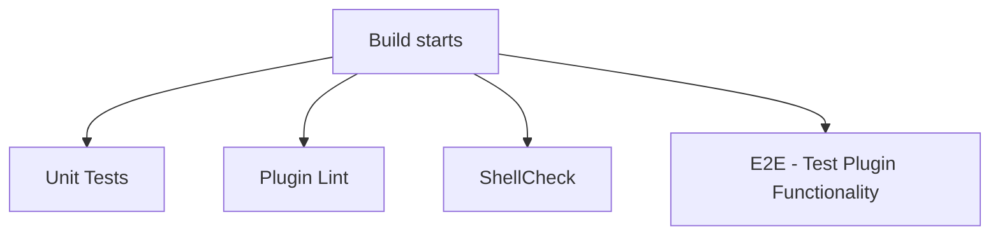

# oblt-google-auth-buildkite-plugin

This Buildkite pipeline runs unit tests, plugin linting, ShellCheck, and an end-to-end Google Cloud authentication check for the `oblt-google-auth` plugin.

## At a glance

| | |
| --- | --- |
| Platform | Buildkite |
| Source | [`.buildkite/pipeline.yml`](../pipeline.yml) |
| Trigger | The pipeline YAML declares no trigger or branch filter. The checked-in pull request integration config enables commit builds and `/test this` or `/test it` comments; see [`.buildkite/pull-requests.json`](../pull-requests.json). |

## Purpose

The checked-in configuration defines validation for the plugin: Bats tests, the Buildkite plugin linter, ShellCheck, and an end-to-end check of Google Cloud authentication. A [2026-03-04 change titled `update to best practices`](https://github.com/elastic/oblt-google-auth-buildkite-plugin/commit/157f1582133ca3f9aa6366af8ab13b2373b1e5f6) expanded the pipeline from a single auth-account check to these validation steps and added the GCP agent configuration and failure notification. The available history does not record the original rationale.

## When it runs

The pipeline YAML does not specify a branch filter or trigger. The checked-in pull request integration config names the pipeline slug `oblt-google-auth-buildkite-plugin` and enables builds on commits and comments beginning with `/test this` or `/test it` (the regex requires one or more non-word separators before `this` or `it`; bare `/test` does not match). It skips builds when the `skip-ci` label is present and when only Markdown files changed. The access settings enable `allow_org_users` and list `admin` and `write` under `allowed_repo_permissions`.

These are checked-in settings; the available sources do not verify the live Buildkite configuration.

## Execution flow

The four command steps have no declared dependencies or waits, so Buildkite runs them independently.

| Job or step | Runs when | Depends on | What it does |
| --- | --- | --- | --- |
| Unit Tests | Every pipeline build | None declared | Runs `make test`, which runs the Bats suite in the `buildkite/plugin-tester:v4.3.0` container. |
| Plugin Lint | Every pipeline build | None declared | Runs `make plugin-lint`, invoking `buildkite/plugin-linter:v3.0.0` for `elastic/oblt-google-auth`. |
| ShellCheck | Every pipeline build | None declared | Runs `make shellcheck`, checking shell files under `hooks` and `.buildkite/scripts`. |
| E2E - Test Plugin Functionality | Every pipeline build | None declared | Loads `elastic/oblt-google-auth#${BUILDKITE_COMMIT}` with a 10,800-second credential lifetime and project `elastic-observability-ci` (number `911195782929`), then runs `make e2e-test`. The script checks that `gcloud auth list` reports an active account and fails otherwise. |

## Inputs, outputs, and access

| Item | Details |
| --- | --- |
| Inputs | `BUILDKITE_COMMIT` selects the plugin revision used by the end-to-end step. The Buildkite plugin is configured with `lifetime`, `project-id`, and `project-number`. |
| Outputs | No artifacts or explicit step outputs are configured. The checks report success or failure through their command exit status. |
| Permissions | The pipeline agent uses the `gcp` provider and `family/core-ubuntu-2204` image. No additional Buildkite token permissions are declared in the checked-in pipeline YAML. |
| Secrets | No secret values or named secret references are present in the pipeline configuration. The end-to-end step uses the plugin's Buildkite OIDC authentication flow. |

## Operational notes

On `main`, a failed build sends a notification to `#observablt-bots`. The pipeline YAML does not declare retries, timeouts, artifacts, dynamic step uploads, or deployment environments.

## Sources and history

- Pipeline: [`.buildkite/pipeline.yml`](../pipeline.yml)
- Pull request integration settings: [`.buildkite/pull-requests.json`](../pull-requests.json)
- Commands and container definitions: [`Makefile`](../../Makefile) and [`docker-compose.yml`](../../docker-compose.yml)
- End-to-end check: [`.buildkite/scripts/test-e2e.sh`](../scripts/test-e2e.sh)
- Plugin configuration: [`plugin.yml`](../../plugin.yml)
- Relevant history: [2026-03-04 `update to best practices`](https://github.com/elastic/oblt-google-auth-buildkite-plugin/commit/157f1582133ca3f9aa6366af8ab13b2373b1e5f6); the original rationale is not recorded in the available history.
